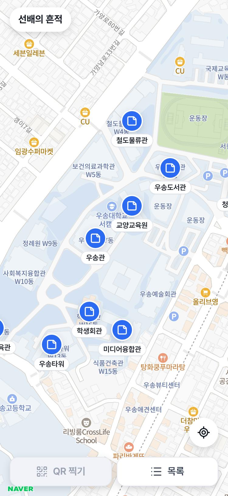
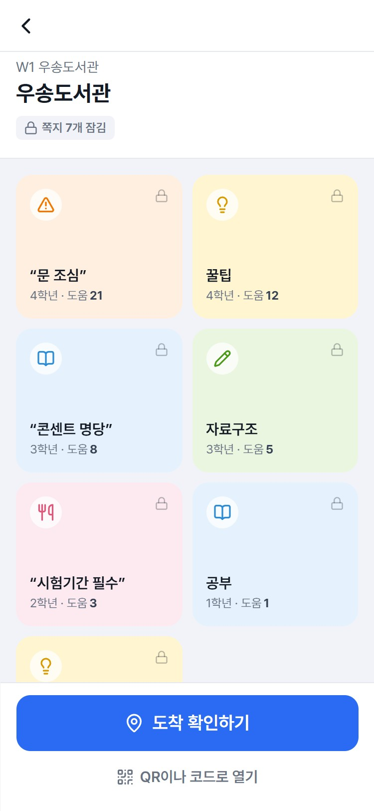
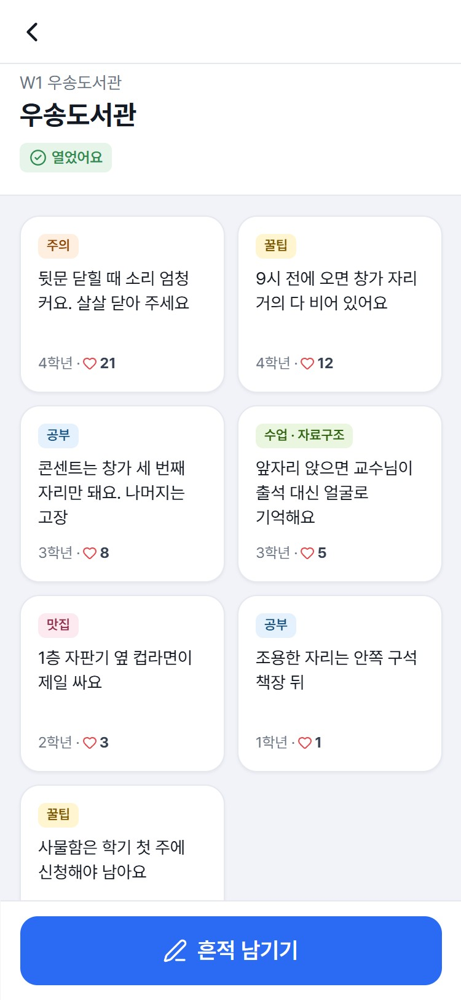
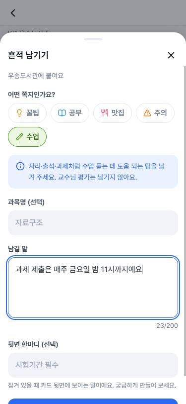

# DOTCI.

> 점 하나, 이야기 하나.

**검색하지 마세요, 도착하세요.**
캠퍼스의 그 장소에 직접 도착해야 선배가 남긴 쪽지가 열리는 위치 기반 웹 서비스입니다.
게시판은 검색해야 찾을 수 있지만, DOTCI는 **장소가 곧 검색어**입니다.

| | 주소 | 설명 |
|---|---|---|
| 정식 서비스 | **https://dotci.vercel.app/** | 진짜 서버·DB에 저장. 홈 화면에 추가하면 앱처럼 쓸 수 있어요 |
| 체험판 | **https://sangukjeon.github.io/dotci/** | 서버 없이 화면만. 예시 데이터로 동작 |

- 대상: 우송대학교 서캠퍼스 **21곳** (도서관, 학생회관, 체육관, 운동장, 기숙사 등) + 전시 부스
- 출품: 2026 비교과 연계 창의융합 협력학습 경진대회 및 전시회 「컴퓨터공학전공 학술제」 (발표 2026-11-05)
- 팀: 전상욱 (총괄·개발) · 이재엽 (UI 디자인·사용자 평가·발표) · 조윤후 (QA)

<p>
  
  
  
  
</p>

---

## 목차

1. [주요 기능](#주요-기능)
2. [기술 구성](#기술-구성)
3. [보안 원칙](#보안-원칙)
4. [체험판 사용법](#체험판-사용법)
5. [정식 서비스 코드 (비공개)](#정식-서비스-코드-비공개)
6. [내 컴퓨터에서 실행하기](#내-컴퓨터에서-실행하기)
7. [배포와 운영](#배포와-운영)
8. [폴더 구조](#폴더-구조)
9. [진행 상황](#진행-상황)

---

## 주요 기능

### 핵심 (실제 서버에서 동작)

| 기능 | 설명 |
|---|---|
| 지도 | 네이버 지도 위 장소 마커와 쪽지 수 배지. 목록은 7곳씩 페이지로 |
| 잠긴 책상 | 도착 전에는 카테고리·작성자 학년·도움됐어요 수·작성자 한마디(힌트)만 보여요. **본문은 서버가 아예 안 보내요** |
| 도착 확인 | GPS(거리 + 정확도 보정) 또는 장소에 붙은 QR · 6자리 코드 |
| 쪽지 쓰기 | 도착한 장소에서만, 30분 안에. 10~200자, 금칙어 검사, 1분에 1개 |
| 도움됐어요 | 연 쪽지에만, 1인 1회, 취소 가능. 도움됐어요 순으로 위에 |
| 회원가입 | 학과 초대 코드 + 캠퍼스 위치 확인. 닉네임은 서버가 자동으로 ("조용한 다람쥐 42") |
| 도감 | 내가 연 장소와 쓴 쪽지 |
| 관리자 | 쪽지 숨기기 · 공지 보내기 · 보낸 공지 지우기 |

### 편의 기능

| 기능 | 설명 |
|---|---|
| 폰 알림 | **공지**(관리자가 보냄)와 **내 쪽지 반응**(도움됐어요 1·3·10·30·100개가 될 때 한 번씩) 두 가지. 가입 때 선택 동의, 처음 켤 때 한 번만 물어봄, 내 정보에서 끄기 |
| 오늘의 학식 | [wsu-meal-api](https://github.com/sangukjeon/wsu-meal-api) 식단을 날짜·식당별로 |
| 서버 깨우기 화면 | 잠든 서버가 깨는 동안 "책상 닦는 중" + 예시 책상 둘러보기 |
| 오프라인 화면 | 인터넷이 끊기면 안내 화면, 다시 연결되면 저절로 닫힘 |
| 비밀번호 강도 | 가입할 때 4칸 막대로 바로 표시 (최종 판단은 서버) |
| 앱 설치 · 미리보기 | 홈 화면 아이콘(PWA), 링크 공유 시 미리보기 이미지 |
| 약관 · 동의 | 이용약관, 개인정보처리방침, 항목별 동의 (알림은 선택) |

### 확장 기능 (화면 완성, 지금은 예시 데이터)

학과 대항전 · 신입생 멘토링 코스 · 과목별 수강 팁 · 쪽지 신고 · 관리자 통계 · 전시 부스 큰 화면 · 로그인 없는 체험(게스트)

---

## 기술 구성

| 역할 | 기술 |
|---|---|
| 화면 | React 19 (Vite), react-router-dom, motion, lucide-react, html5-qrcode |
| 지도 | 네이버 지도 API (NAVER Cloud Maps, Web Dynamic Map) |
| 서버 | Python **FastAPI**, SQLModel, bcrypt, PyJWT, pywebpush |
| DB | PostgreSQL (Neon, 싱가포르) |
| 알림 | Web Push 표준 + VAPID 키, 서비스 워커(`sw.js`) |
| 배포 | 정식: Vercel + Render + Neon · 체험판: GitHub Pages · 서버 감시: UptimeRobot |
| 테스트 | pytest **41개** |

```
폰 브라우저 → https://dotci.vercel.app (Vercel)
              ├─ /       → React 화면              (frontend/)
              └─ /api/*  → Render의 FastAPI → Neon (backend/)
```

`/api`를 Vercel이 Render로 넘겨 주기 때문에 화면과 서버가 같은 주소처럼 동작합니다.
그래서 CORS 설정 없이 httpOnly 쿠키로 로그인할 수 있어요.

**판단은 모두 Python 서버가 합니다.**
도착 거리 계산(`geo.py`), 잠긴 쪽지 본문 차단, 30분 쓰기 토큰, 비밀번호 검사(`passwords.py`), 자동 닉네임, 알림 발송까지 전부 서버 코드입니다.
LLM API(ChatGPT, Claude 등)는 쓰지 않습니다.

---

## 보안 원칙

| 겹 | 하는 일 |
|---|---|
| 로그인 | bcrypt 해시만 저장, JWT는 자바스크립트가 못 읽는 쿠키에, 5번 틀리면 10분 잠금, 흔한 비밀번호 거절 |
| 가입 | 학과 초대 코드(횟수 제한·교체 가능) + 캠퍼스 위치 확인, 실명·학번·전화·이메일 안 받음 |
| 잠금 | 잠긴 쪽지 본문 미전송, 서명된 30분 쓰기 토큰, 해제 시도 1분 10회 제한 |
| 데이터 | SQLModel 쿼리만 사용(SQL 문자열 조립 금지), 위치 좌표 저장 안 함, QR 값·6자리 코드는 응답에 안 나감 |
| 알림 | 구글·애플·모질라·MS 푸시 서버 주소만 받음, 끊긴 구독 자동 삭제, 탈퇴하면 구독도 삭제 |
| 비밀값 | DB 주소·JWT 키·VAPID 비밀키는 `.env`와 배포 환경변수에만. Git에는 `.env.example`만 |

---

## 체험판 사용법

**👉 https://sangukjeon.github.io/dotci/**

- 쪽지·로그인·도착 확인 모두 브라우저 안의 **예시 데이터**입니다. 실제 선배의 팁이 아니에요.
- 새로고침하면 처음 상태로 돌아가고, 다른 사람과 공유되지 않습니다.
- 지도 대신 **장소 목록**으로 보입니다. (네이버 지도는 등록한 주소에서만 동작)
- 진짜 비밀번호는 넣지 마세요.

### 체험용 아이디

처음 입력한 비밀번호(8자 이상)를 그 아이디의 비밀번호로 기억합니다. 아무 아이디나 새로 만들어도 돼요.

| 용도 | 아이디 | 비밀번호 |
|---|---|---|
| 일반 학생 | `woosong24` | `dotci-demo` |
| 관리자 | `admin-demo` | `dotci-demo` |

- 아이디가 `admin`으로 시작하면 관리자로 로그인됩니다.
- 가입용 초대 코드(체험판 전용): `CSE-2026` (컴퓨터공학과) · `EE-2026` (전자공학과) · `BIZ-2026` (경영학과)
- 가입 3단계 "학교에 있어요"에는 아래 6자리 코드를 넣으면 됩니다.

### 해 볼 것

| 해 보기 | 방법 |
|---|---|
| 잠긴 쪽지 보기 | 목록에서 장소 선택 → 카테고리·힌트만 보여요 |
| QR로 열기 | 주소 끝에 `place/w1-library?qr=MOCKQR1` → 카드가 뒤집히며 열려요 |
| 6자리 코드로 열기 | 책상에서 `100001` 입력 (우송도서관) |
| 도착 실패 안내 | `place/w1-library?mock=far` (거리 멂) · `?mock=blur` (위치 흐림) |
| 쪽지 쓰기 · 도움됐어요 | 책상을 연 뒤 "흔적 남기기", 카드의 하트 |
| 관람객 모드 | 로그인 화면 "로그인 없이 체험하기" |
| 도감 · 수료증 | `me?mock=complete` |
| 확장 기능 | `ranking` · `courses` · `subjects` · `meals` |
| 관리자 화면 | `admin`으로 시작하는 아이디로 로그인 → `admin` (쪽지 관리 · 통계 · 공지) |

### 체험판 장소 코드

> 체험판 전용 예시 값입니다. 정식 서비스 코드는 [아래 표](#장소-코드-6자리)를 보세요.

<details>
<summary>22곳 펼치기</summary>

| 장소 | 건물 | 6자리 코드 | 바로 열기 (체험판 주소 뒤에 붙이기) |
|---|---|---|---|
| 우송도서관 | W1 | `100001` | `place/w1-library?qr=MOCKQR1` |
| 철도물류관 | W4 | `100002` | `place/w4-railway?qr=MOCKQR2` |
| 교양교육원 | W6 | `100003` | `place/w6-liberal?qr=MOCKQR3` |
| 우송관 | W7 | `100004` | `place/w7-admin?qr=MOCKQR4` |
| 서캠 체육관 | W11 | `100005` | `place/w11-gym?qr=MOCKQR5` |
| 우송타워 | W13 | `100006` | `place/w13-tower?qr=MOCKQR6` |
| 학생회관 | W16 | `100007` | `place/w16-union?qr=MOCKQR7` |
| 미디어융합관 | W17 | `100008` | `place/w17-media?qr=MOCKQR8` |
| 청운1숙(남) | 기숙사 | `100009` | `place/dorm-cheongun1?qr=MOCKQR9` |
| 전시 부스 | 전시회 | `100010` | `place/booth?qr=MOCKQR10` |
| 운동장 | 서캠 운동장 | `100011` | `place/field?qr=MOCKQR11` |
| 국제교육센터 | W2 | `100012` | `place/w2-intl?qr=MOCKQR12` |
| 유학생기숙사 | W3 | `100013` | `place/w3-intldorm?qr=MOCKQR13` |
| 보건의료과학관 | W5 | `100014` | `place/w5-health?qr=MOCKQR14` |
| 우송유치원 | W8 | `100015` | `place/w8-kinder?qr=MOCKQR15` |
| 정례원 | W9 | `100016` | `place/w9-jeongnye?qr=MOCKQR16` |
| 사회복지융합관 | W10 | `100017` | `place/w10-welfare?qr=MOCKQR17` |
| SICA | W12 | `100018` | `place/w12-sica?qr=MOCKQR18` |
| 컬리너리센터 | W14 | `100019` | `place/w14-culinary?qr=MOCKQR19` |
| 식품건축관 | W15 | `100020` | `place/w15-food?qr=MOCKQR20` |
| 우송예술회관 | W18 | `100021` | `place/w18-art?qr=MOCKQR21` |
| 엔디컷 빌딩 | W19 | `100022` | `place/w19-endicott?qr=MOCKQR22` |

</details>

---

## 정식 서비스 코드 (비공개)

> ⚠️ 저장소가 **비공개**라서 적어 둔 실제 값입니다.
> 저장소를 공개로 바꾸기 전에 반드시 이 절을 지우고, `backend/rotate_invites.py`로 초대 코드를, 장소 코드도 새로 바꾸세요.

### 학과 초대 코드 (2026-11-03 교체)

| 학과 | 초대 코드 | 최대 가입 |
|---|---|---|
| 컴퓨터공학과 | `CSE-4H6N7K` | 50명 |
| 전자공학과 | `EE-PT57E3` | 50명 |
| 경영학과 | `BIZ-Q7HM8T` | 50명 |

### 장소 코드 (6자리)

2026-11-04 기준입니다. 책상 화면 "QR이나 코드로 열기"나 가입 3단계 "장소 코드 6자리"에 넣으면 그 장소에 도착한 것으로 열려요.
QR에 들어가는 긴 값은 `backend/qr_codes.local.csv`에 있어요. (Git에는 안 올라감)

<details>
<summary>21곳 펼치기</summary>

| 장소 | 건물 | 6자리 코드 |
|---|---|---|
| 우송도서관 | W1 | `465287` |
| 국제교육센터 | W2 | `533883` |
| 유학생기숙사 | W3 | `716398` |
| 철도물류관 | W4 | `887926` |
| 보건의료과학관 | W5 | `498340` |
| 교양교육원 | W6 | `794582` |
| 우송관 | W7 | `611366` |
| 우송유치원 | W8 | `104420` |
| 정례원 | W9 | `654219` |
| 사회복지융합관 | W10 | `079160` |
| 서캠 체육관 | W11 | `289738` |
| SICA | W12 | `180664` |
| 우송타워 | W13 | `785905` |
| 컬리너리센터 | W14 | `976224` |
| 식품건축관 | W15 | `378166` |
| 학생회관 | W16 | `761795` |
| 미디어융합관 | W17 | `584580` |
| 우송예술회관 | W18 | `068194` |
| 엔디컷 빌딩 | W19 | `587613` |
| 청운1숙(남) | 기숙사 | `099737` |
| 운동장 | 서캠 운동장 | `667139` |

</details>

---

## 내 컴퓨터에서 실행하기

Windows 기준입니다.

### 1. 서버 (backend)

```bash
cd backend
python -m venv .venv
.venv/Scripts/python -m pip install -r requirements.txt
cp .env.example .env          # 값 채우기. DATABASE_URL을 비워 두면 SQLite(dev.db) 사용
.venv/Scripts/python seed.py  # 학과·초대 코드·장소 넣기
.venv/Scripts/uvicorn app.main:app --reload --port 8000
```

API 설명 화면: http://localhost:8000/api/docs

| 하고 싶은 일 | 명령 |
|---|---|
| 자동 테스트 | `.venv/Scripts/python -m pip install -r requirements-dev.txt` 후 `.venv/Scripts/python -m pytest` |
| 관리자 지정 (가입한 뒤) | `.venv/Scripts/python make_admin.py 아이디` |
| 초대 코드 교체 (유출됐을 때) | `.venv/Scripts/python rotate_invites.py` |
| 알림 키 만들기 | `.venv/Scripts/python make_vapid.py` → 출력된 값을 `.env`에 |

### 2. 화면 (frontend)

새 터미널에서:

```bash
cd frontend
npm install
cp .env.example .env          # 네이버 지도 Client ID 넣기. 비워 두면 목록 화면
npm run dev
```

http://localhost:5173 접속. `/api` 요청은 자동으로 8000번 서버로 넘어갑니다.

체험판으로 실행하기 (서버 없이): `frontend/.env`에 `VITE_DEMO=1`을 넣고 `npm run dev`

---

## 배포와 운영

| 무엇 | 어디 | 설정 |
|---|---|---|
| DB | Neon (ap-southeast-1) | `DATABASE_URL`로 `seed.py` 실행. QR 값은 `qr_codes.local.csv`에만 |
| 서버 | Render (Singapore, 무료) | `render.yaml`을 Blueprint로. 대시보드에서 직접 입력: `DATABASE_URL`, `VAPID_PUBLIC_KEY`, `VAPID_PRIVATE_KEY`, `VAPID_SUBJECT`. `JWT_SECRET`은 Render가 자동 생성 |
| 화면 | Vercel | Root Directory `frontend`. `vercel.json`이 `/api/*`를 Render로 넘김. 환경변수 `VITE_NAVER_MAP_CLIENT_ID` |
| 체험판 | GitHub Pages | `main`에 올리면 GitHub Actions(`.github/workflows/pages.yml`)가 자동 빌드 |
| 서버 깨우기 | UptimeRobot | 5분마다 `https://dotci-api.onrender.com/api/health` 확인 (HEAD 요청 허용) |

- `main`에 푸시하면 Vercel과 Render가 자동으로 다시 배포합니다.
- Render 무료 서버는 15분 동안 요청이 없으면 잠듭니다. UptimeRobot이 깨워 두고, 그래도 잠들면 화면이 "책상 닦는 중"을 보여 주며 기다립니다.
- 네이버 지도는 NAVER Cloud 콘솔의 Web 서비스 URL에 `http://localhost:5173`과 `https://dotci.vercel.app`이 등록되어 있어야 동작합니다.

---

## 폴더 구조

```
seonbae-trace/
├─ backend/                 Python 서버
│  ├─ app/
│  │  ├─ main.py            앱 시작, /api/health
│  │  ├─ geo.py             하버사인 거리 + GPS 정확도 판정
│  │  ├─ passwords.py       흔한 비밀번호 거절
│  │  ├─ nicknames.py       자동 닉네임
│  │  ├─ banned.py          금칙어
│  │  ├─ models.py          DB 테이블 (SQLModel)
│  │  └─ routers/           auth · places · notes · push
│  ├─ tests/                pytest 41개
│  └─ seed.py · make_admin.py · rotate_invites.py · make_vapid.py
├─ frontend/                React 화면
│  ├─ public/               sw.js · offline.html · manifest · 아이콘 · og.png
│  └─ src/
│     ├─ pages/ · components/
│     ├─ server.js          체험판이면 mock/, 아니면 realServer.js
│     └─ api.js             서버 요청 (깨우기·재시도 포함)
├─ docs/screenshots/        화면 캡처
├─ render.yaml              Render 설정
├─ CLAUDE.md                기획·결정 사항
└─ DESIGN.md                디자인 규칙
```

---

## 진행 상황

- [x] 모든 화면 · 체험판 배포 (GitHub Pages)
- [x] 서버: 로그인·가입, 쪽지 조회·잠금 해제·쓰기, 도움됐어요, 관리자, 도감
- [x] 정식 배포 (Vercel + Render + Neon) · 네이버 지도 연결
- [x] 장소 21곳 · QR · 6자리 코드
- [x] 약관·개인정보처리방침·항목별 동의
- [x] 오늘의 학식
- [x] 폰 알림 (공지 · 내 쪽지 반응), 오프라인 화면, 비밀번호 강도, 앱 아이콘(PWA), 링크 미리보기
- [x] 서버 감시 (UptimeRobot)
- [x] 발표 (2026-11-05)
- [ ] 확장 기능 서버 연결: 학과 대항전, 멘토링 코스, 과목별 팁, 신고, 관리자 통계, 게스트 모드, 전시 큰 화면
- [ ] 아이디어: 쪽지 덧붙이기, 장소 코드 정기 교체, 동캠퍼스 확장

---

## 문서

- 기획·결정 사항: [CLAUDE.md](CLAUDE.md)
- 디자인 규칙: [DESIGN.md](DESIGN.md)

장소 좌표 출처: © OpenStreetMap contributors (ODbL)
